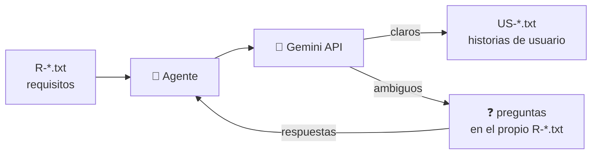
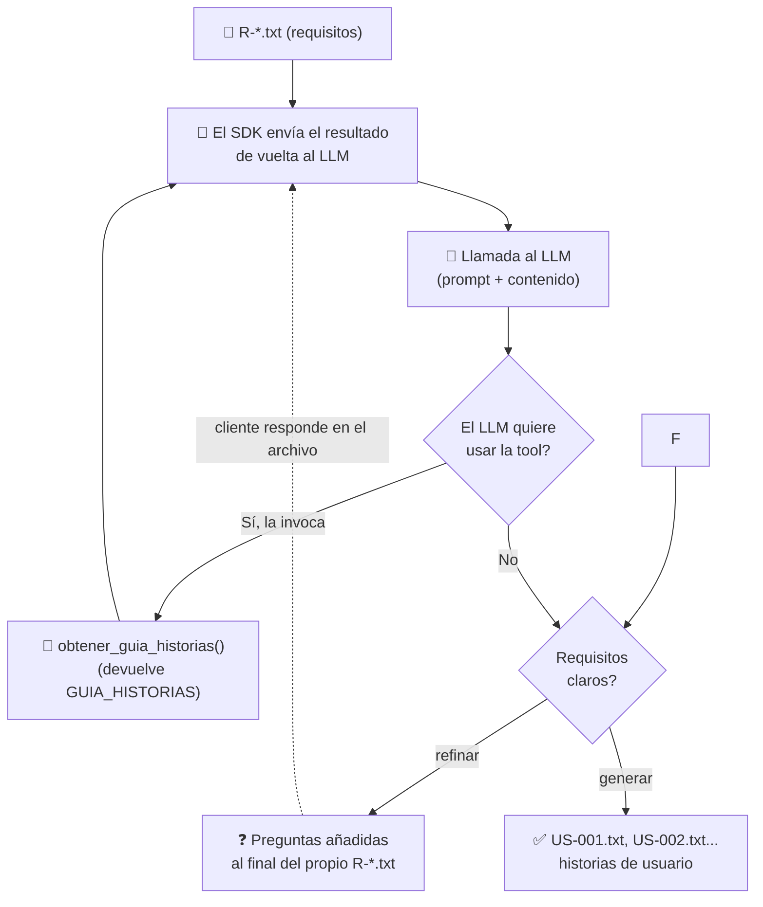

# 🤖 Hands On Lab: Creando nuestro primer agente de IA

Construye el primer agente de tu propia "factoría de desarrollo": el **agente refinador de requisitos**.

## 🎯 Qué vas a construir

Un agente que:

- 👀 Vigila una carpeta buscando archivos de requisitos (`R-*.txt`)
- 🧠 Los analiza con un LLM (Gemini)
- ❓ Si son ambiguos → añade preguntas al final del propio archivo
- ✅ Si están claros → genera historias de usuario (`US-001.txt`, `US-002.txt`…)



### Cuando se usa el bucle agéntico el ciclo sería este:



## 🛠️ Requisitos previos

Antes del workshop, ten listo:

1. **Python 3.10+** — `winget install Python.Python.3.13` (o desde [python.org](https://python.org))
	- En Windows Powershell: winget install Python.Python.3.13
2. **API key gratis de Google AI Studio** (2 minutos, sin tarjeta):
   - Entra en [aistudio.google.com](https://aistudio.google.com) con tu cuenta Google
   - Menú lateral → **Get API key** → **Create API key**
   - Copia la clave (`AIza...`) y guárdala 🔒
3. **SDK de Gemini** — `pip install google-genai`

## 🚀 Puesta en marcha

```bash
# 1. Configura tu API key como variable de entorno
export GEMINI_API_KEY="AIza..."        # Linux / macOS
set GEMINI_API_KEY=AIza...             # Windows CMD
$env:GEMINI_API_KEY="AIza..."         # PowerShell

# 2. Crea la carpeta y un requisito de ejemplo
mkdir especificaciones
# ...guarda ahí un R-001.txt

# 3. ¡Lanza el agente!
python Refinador.py
```

## 📁 Estructura del proyecto

```
├── Refinador.py            # el agente
└── especificaciones/       # carpeta vigilada
    ├── R-001.txt           # requisitos de entrada
    ├── R-002.txt
    └── US-001.txt          # historias generadas ✨
```

## 🪜 Niveles del lab

| Nivel | Reto | Concepto |
|---|---|---|
| 1️⃣ | Leer `R-*.txt` → LLM → escribir `US-*.txt` | El bucle básico del agente |
| 2️⃣ | JSON mode: respuesta estructurada y fiable | Parsing robusto |
| 3️⃣ | Convertir la guía de historias en una **tool** | El LLM decide cuándo usarla 🔥 |

## ⚠️ Regla de oro

> 🔒 **Nunca pegues tu API key en el código.** Usa siempre la variable de entorno `GEMINI_API_KEY`. Si la expones, revócala en AI Studio y genera otra.

## 🗓️ Agenda (2,5 h)

| Hora | Sesión |
|---|---|
| 0:00 – 0:30 | Intro: agentes especializados en el ciclo de vida software |
| 0:30 – 1:30 | 💻 Hands-on: construyendo el agente |
| 1:30 – 2:00 | Demos: refinar vs generar, el ciclo iterativo |
| 2:00 – 2:30 | Conclusiones y siguientes agentes de la factoría |

---

*¿Siguiente parada? El agente planificador.* 🏭
